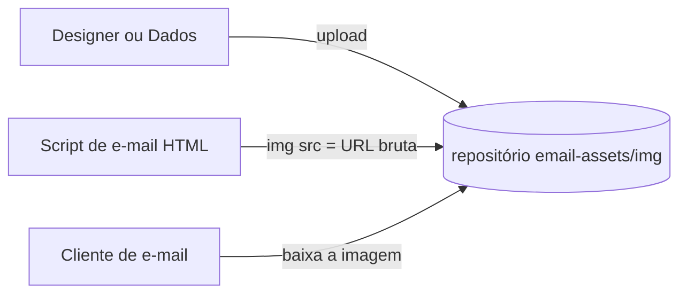

# Imagens de e-mail (`email-assets`) — Documentação técnica e funcional

> Repositório: `Cia-Talentos-DataHub/email-assets` (**público**, 5 commits de maio/2025, autoria Anderson Lima Rocha). Repositório apenas de **imagens** usadas nos e-mails automáticos enviados pela equipe de dados (assinatura e banners). O `README` original tem uma linha: "Pasta dedicada a imagens". Não há código, banco, build nem site (GitHub Pages **não** está habilitado). Escrito para que alguém que nunca viu o repositório entenda seu papel e consiga **recriá-lo**.

## 1. O que é e para quem serve
**Problema de negócio.** Clientes de e-mail (Outlook, Gmail) bloqueiam imagens anexadas; para exibir logo e banners em e-mails automáticos (por exemplo os avisos do Projeto 80/20 e dos pipelines de dados), é comum referenciar imagens por **URL pública**. Este repositório funciona como um "CDN" simples: o e-mail aponta para o arquivo bruto no GitHub.

| Perfil | Uso |
|---|---|
| Time de Dados (Data Process) | Sobe imagens e as referencia por URL nos modelos de e-mail. |
| Destinatários dos e-mails | Veem a assinatura e os banners. |

## 2. Glossário
| Termo | Significado |
|---|---|
| **Asset** | Arquivo de imagem usado no corpo HTML do e-mail. |
| **URL bruta** | `https://raw.githubusercontent.com/Cia-Talentos-DataHub/email-assets/main/img/<arquivo>`. |

## 3. Fluxo


## 4. Arquitetura, stack e arquivos
Somente a pasta `img/`:
| Arquivo | Uso provável (pelo nome) |
|---|---|
| `logo-assinatura-ciatalentos.png` | Logo da assinatura de e-mail da Cia de Talentos. |
| `email.webp`, `email_icon.png` | Banner e ícone de e-mail. |
| `timedados.png`, `timedados_icon.png`, `time de dados.avif` | Marca/ícone do "Time de Dados" nos avisos automáticos. |

## 5–8. Variáveis, banco, autenticação, interfaces
Não se aplicam. O acesso é público por URL.

## 9. Regras de negócio
1. Nomes de arquivo devem ser estáveis: renomear ou apagar quebra as imagens de e-mails já enviados.
2. Formatos `.webp` e `.avif` **não são suportados** por vários clientes de e-mail (principalmente o Outlook desktop); usar `.png` ou `.jpg` nos modelos.
3. Nomes com espaço (`time de dados.avif`) exigem codificação da URL (`%20`).

## 10. Roteiro para recriar e checklist
1. Criar o repositório público com a pasta `img/`.
2. Subir as imagens em PNG/JPG, com largura máxima de ~600 px.
3. Referenciar nos modelos de e-mail usando a URL bruta e `width`/`alt` explícitos.

**Checklist**: [ ] só imagens institucionais (sem dados de pessoas) · [ ] formatos compatíveis · [ ] `alt` em todas · [ ] domínio próprio para produção.

## 11. Apêndices — código-fonte real
Não há código. Exemplo de uso em HTML de e-mail:
```html

```

## 12. Pontos de atenção
| # | Achado | Impacto / recomendação |
|---|---|---|
| 1 | Repositório **público** da organização usado como hospedagem de imagens | Aceitável para logos, mas qualquer alteração indevida muda todos os e-mails; proteger a branch `main`. |
| 2 | Dependência do `raw.githubusercontent.com` | O GitHub limita taxa e pode bloquear uso como CDN; para volume alto, usar CDN ou storage próprio. |
| 3 | Formatos `webp`/`avif` e nomes com espaço | Imagens quebradas em alguns clientes de e-mail. |
| 4 | README mínimo e sem inventário | Não se sabe em quais e-mails cada imagem é usada; documentar. |
| 5 | Imagens de pessoas ("time de dados") sem registro de consentimento de uso | Verificar direitos de imagem. |
